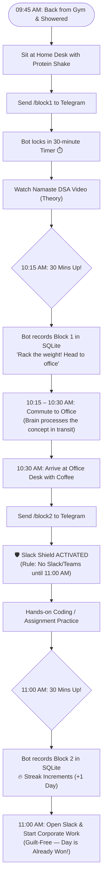

# Product Requirement Document (PRD)

## Product Name: Tech Spotter (Digital Body Double & Consistency Engine)
**Version:** 1.0.0  
**Target User:** 26-Year-Old Software Engineer & Fitness Enthusiast  
**Platform:** Telegram Bot (Python 3.11+, `python-telegram-bot`, SQLite)  
**Primary Goal:** Eliminate study procrastination on DSA (*Akshay Saini's Namaste DSA*) and side projects through behavioral anchoring, body doubling, and zero-overhead streak tracking.

---

## 1. Problem Statement & Psychological Context

### 1.1 The User Persona
* **Fitness Disciplined:** Already wakes up at 6:00 AM, trains hard in the gym (7:00 – 8:30 AM). Demonstrates high physical consistency.
* **Evening Cognitive Drain:** Returning from a 9-hour corporate software engineering job leaves the prefrontal cortex depleted. Attempting to study in the evening triggers severe mental friction, leading to procrastination, phone scrolling, guilt, and a disrupted sleep schedule (sleeping late, waking up tired).
* **Course Context:** Currently studying *Namaste DSA by Akshay Saini*. Knows what to study, but struggles with the friction of sitting down and executing.

### 1.2 Core Solution Philosophy
1. **Time-Shifting (The Golden Pre-Work Window):** Relocate learning to the morning (09:45 – 11:00 AM) when mental energy and post-gym endorphins are at their peak.
2. **Body Doubling (Virtual Spotter):** Mimic a gym spotter. The user commits to a session, an active countdown timer runs, and completion is formally acknowledged.
3. **The Slack Shield:** Protect the office arrival transition (10:30 – 11:00 AM) so corporate communications do not hijack personal growth time.
4. **Zero-Overhead Tracking:** No complex ticketing, syllabus logging, or multi-step forms. Binary consistency tracking with an automated streak break audit log.

---

## 2. Daily User Journey & Schedule Map

| Time Window | Location | Activity | Spotter Bot Role |
| :--- | :--- | :--- | :--- |
| **06:00 – 08:30 AM** | Gym | Strength training | Silent |
| **08:30 – 09:45 AM** | Commute / Home | Shower, breakfast, protein shake | Silent |
| **09:45 – 10:15 AM** | Home Desk | **Block 1: Theory (Namaste DSA Video)** | User initiates `/block1` or `/block`. Spotter starts 30-min countdown. |
| **10:15 – 10:30 AM** | Commute | Travel to office | **Diffuse Mode:** Brain naturally digests the concept in transit. |
| **10:30 – 11:00 AM** | Office Desk | **Block 2: Hands-on Code / Assignment** | User initiates `/block2` or `/block`. Spotter activates **Slack Shield**. |
| **11:00 AM – Evening** | Office | Corporate software engineering | Corporate Slack/Teams unlocked. |
| **Evening** | Home | Dinner, rest, leisure | **100% Guilt-Free.** Rest and recovery. |
| **10:00 PM** | Home | Wind-down preparation | Gentle sleep reminder to ensure 7-hour rest for 6:00 AM gym. |
| **Saturday / Sunday** | Home Desk | **Weekend Side Project Sprints** | Flexible bonus blocks (`/block 60`) for shipping atomic features. |

### 2.1 Morning Double-Rep Flowchart



---

## 3. Functional Requirements

### 3.1 Bot Commands

| Command | Arguments | Description |
| :--- | :--- | :--- |
| `/start` | None | Welcome message, user authentication check, and usage instructions. |
| `/block` | `[minutes]` (default: 30) | Starts a focus block. Auto-increments today's block number (Block 1, 2, 3...). |
| `/block1` | None | Explicit shortcut for Block 1 (Theory / Morning Home Session). |
| `/block2` | None | Explicit shortcut for Block 2 (Code / Office Desk Session with Slack Shield). |
| `/stop` | None | Cancels an ongoing block timer prematurely. |
| `/status` | None | Shows live status: active timer (if running), blocks completed today, current streak, best streak. |
| `/history` | None | Shows past 7 days of completed blocks and deep work minutes. |
| `/breaks` | None | Shows the audit log of when streaks were broken and how many days were lost. |

### 3.2 Dynamic Block Rules
* **No Artificial Limits:** The user is not capped at 2 blocks. If they choose to do a 3rd or 4th block on weekends or evenings, the bot logs them as "Bonus Reps".
* **Active Timer Guard:** If a block is already running, triggering a new block must warn the user and show remaining minutes instead of starting overlapping timers.

### 3.3 Body-Doubling Interaction Flow
1. **Session Commitment:** User types `/block` (or `/block 45`).
   * *Bot Response:* "👀 Spotter locked in for Block X. Timer: 30 minutes. Phone face-down. I'm watching the clock. Lock in."
2. **Session Completion:** When timer reaches $T = 0$:
   * *Bot Response:* "🔔 Ding! 30 minutes up. Rack the weight! Today's Total: X blocks (Y mins deep work). Streak: Day Z 🔥."
3. **Slack Shield Enforcer (Block 2 Specific):**
   * Reminds the user that corporate communication apps (Slack, Teams, Outlook) must remain closed until the 11:00 AM bell rings.

---

## 4. Database Architecture (SQLite: `spotter.db`)

All data must be stored locally in SQLite to guarantee zero cost, low latency, and offline persistence.

### 4.1 Schema Definitions

```sql
-- Table 1: Log every completed focus block
CREATE TABLE IF NOT EXISTS daily_logs (
    id INTEGER PRIMARY KEY AUTOINCREMENT,
    date TEXT NOT NULL,               -- Format: YYYY-MM-DD
    block_number INTEGER NOT NULL,    -- 1, 2, 3, etc. for that day
    duration_mins INTEGER NOT NULL,   -- e.g., 30, 45, 60
    completed_at TIMESTAMP DEFAULT CURRENT_TIMESTAMP
);

-- Table 2: Singleton table tracking live streak status
CREATE TABLE IF NOT EXISTS streak_state (
    id INTEGER PRIMARY KEY CHECK (id = 1),
    current_streak INTEGER DEFAULT 0,
    longest_streak INTEGER DEFAULT 0,
    last_active_date TEXT,            -- Format: YYYY-MM-DD
    total_blocks_completed INTEGER DEFAULT 0,
    total_minutes_completed INTEGER DEFAULT 0
);

-- Table 3: Audit log recording every broken streak event
CREATE TABLE IF NOT EXISTS streak_break_log (
    id INTEGER PRIMARY KEY AUTOINCREMENT,
    broken_on_date TEXT NOT NULL,     -- Date when break was recognized (YYYY-MM-DD)
    lost_streak_count INTEGER NOT NULL, -- Number of consecutive days that were lost
    recorded_at TIMESTAMP DEFAULT CURRENT_TIMESTAMP,
    notes TEXT DEFAULT 'Missed daily block'
);
```

### 4.2 Streak & Break Evaluation Logic
Every time a block completes:
1. Fetch `last_active_date` from `streak_state`.
2. Compute `delta_days = today - last_active_date`.
3. **If `delta_days == 0` (Same day):**
   * Increment today's block count. Streak remains unchanged.
4. **If `delta_days == 1` (Consecutive day):**
   * `current_streak += 1`
   * Update `longest_streak = max(longest_streak, current_streak)`
   * Update `last_active_date = today`
5. **If `delta_days > 1` (Streak broken):**
   * Insert entry into `streak_break_log` (`lost_streak_count = current_streak`, `broken_on_date = yesterday`).
   * Reset `current_streak = 1` (since the user just completed a block today).
   * Update `last_active_date = today`.

---

## 5. Non-Functional & Security Requirements

1. **Security / Single-User Whitelist:**
   * Only messages originating from `YOUR_TELEGRAM_USER_ID` are processed.
   * All requests from unauthorized chat IDs are silently ignored.
2. **Asynchronous Non-Blocking Engine:**
   * Must use `python-telegram-bot` v20+ with `asyncio` and `context.job_queue`.
   * Under no circumstances should `time.sleep()` be called, ensuring the bot remains responsive to commands at all times.
3. **Zero Financial Cost:**
   * Telegram Bot API: 100% Free.
   * Database: Local SQLite (Free).
   * Hosting: Local background task (Windows Task Scheduler / PM2) or Free Cloud Tier (Koyeb / Render).

---

## 6. Implementation Checklist for Antigravity IDE

- [ ] **Step 1:** Create project directory structure (`tech-spotter-bot/`).
- [ ] **Step 2:** Generate `requirements.txt` (`python-telegram-bot>=20.0`, `pytz`).
- [ ] **Step 3:** Implement `database.py` with SQLite initialization, block logging, streak updates, and break audit functions.
- [ ] **Step 4:** Implement `bot.py` containing Telegram command handlers, async job scheduling, Slack Shield logic, and security middleware.
- [ ] **Step 5:** Create `.env.example` for `TELEGRAM_BOT_TOKEN` and `TELEGRAM_USER_ID`.
- [ ] **Step 6:** Run test suite / manual verification simulating Block 1, Block 2, and streak break transitions.
- [ ] **Step 7:** Deploy via selected Free Hosting Strategy (Cloud or Local Daemon).

---

## 7. Free Hosting Architecture & Deployment Guide

To ensure zero monthly costs while keeping the bot online 24/7, choose from one of the three verified free deployment methods below:

### 7.1 Free Hosting Comparison

| Option | Cost | 24/7 Uptime? | Persistent Storage | Setup Difficulty | Best For |
| :--- | :--- | :--- | :--- | :--- | :--- |
| **A. Koyeb (Cloud)** | **$0 / Free** | Yes (No sleeping) | Ephemeral on free redeploy | Easy (Git push) | Best for 24/7 cloud without keeping laptop open |
| **B. PythonAnywhere** | **$0 / Free** | Yes | **Permanent Disk** (Built-in) | Very Easy | Best simplicity for Python + local SQLite |
| **C. Local PM2 (Laptop)**| **$0 / Free** | When laptop is on | **100% Local & Private** | Instant (1 command) | Best for zero cloud configuration & pure privacy |

---

### 7.2 Strategy A: 24/7 Cloud Hosting via Koyeb (Step-by-Step)

Koyeb offers a free Eco tier that runs Docker/Python background workers 24/7 without forcing them to sleep.

#### Configuration Files Required:

1. **`Procfile`** (Tells the cloud runner how to start the bot):
   ```text
   worker: python bot.py
   ```

2. **`requirements.txt`**:
   ```text
   python-telegram-bot>=20.0
   pytz
   python-dotenv
   ```

#### Deployment Steps:
1. Initialize git and push your code to a private GitHub repository:
   ```bash
   git init
   git add .
   git commit -m "feat: initial spotter bot"
   git push origin main
   ```
2. Log in to [Koyeb.com](https://www.koyeb.com/) (Sign up with GitHub).
3. Click **Create App** $\rightarrow$ Select **GitHub**.
4. Choose your `tech-spotter-bot` repository and branch `main`.
5. Under **Service Type**, choose **Worker** (or Web Service if running a dummy port).
6. Under **Environment Variables**, add:
   * `TELEGRAM_BOT_TOKEN` = `your_bot_token_from_botfather`
   * `TELEGRAM_USER_ID` = `your_numerical_id`
7. Click **Deploy**. Koyeb builds the container and keeps it running continuously for free.

> [!TIP]
> **Cloud Database Persistence Note:**  
> If deploying to containerized cloud tiers where local disk resets on rebuilds, you can keep SQLite 100% free forever by using **[Turso](https://turso.tech/)** (Free tier gives 9 GB of cloud SQLite with zero latency and zero credit card required).

---

### 7.3 Strategy B: PythonAnywhere (Native Free Python Host)

PythonAnywhere provides a dedicated Python Linux environment with permanent disk storage for SQLite on the free tier.

#### Deployment Steps:
1. Create a free account at [PythonAnywhere.com](https://www.pythonanywhere.com/).
2. Open a **Bash Console** from the dashboard.
3. Clone your repo or upload files:
   ```bash
   git clone https://github.com/your-username/tech-spotter-bot.git
   cd tech-spotter-bot
   pip install -r requirements.txt --user
   ```
4. Set environment variables in your virtualenv / `.bashrc` or create a `.env` file.
5. Under the **Tasks** or **Always-on tasks** tab, configure `python3 /home/yourusername/tech-spotter-bot/bot.py`.
6. Your SQLite `spotter.db` resides on PythonAnywhere's persistent filesystem and is never wiped.

---

### 7.4 Strategy C: Local Background Daemon on Your Laptop (Zero Cloud Hassle)

If you use your laptop daily between 09:00 AM and 11:00 AM anyway, running the bot locally in the background is the fastest, safest, and most private method.

#### Deployment Steps via PM2:
1. Install PM2 (Process Manager):
   ```bash
   npm install -g pm2
   ```
2. Navigate to your project folder and start the bot as a background daemon:
   ```bash
   pm2 start bot.py --name "spotter-bot" --interpreter python
   ```
3. Save the process so it auto-restarts on laptop reboot:
   ```bash
   pm2 save
   ```
* **Memory usage:** Under 25 MB RAM.
* **CPU usage:** 0.0%.
* Runs silently in the background while keeping all database logs directly on your machine.
